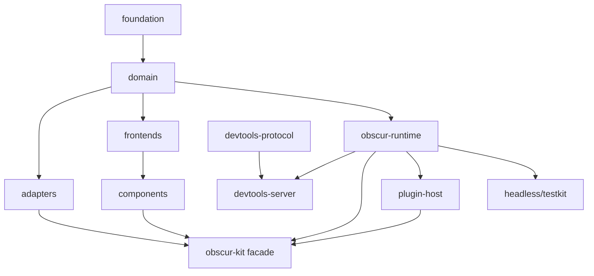

# 2. Каталог крейтов и граф зависимостей

## 2.1 Целевая структура workspace

```text
obscur-kit/
├── Cargo.toml
├── Cargo.lock
├── rust-toolchain.toml
├── deny.toml
├── clippy.toml
├── crates/
│   ├── foundation/
│   │   ├── obscur-identity/
│   │   ├── obscur-geometry/
│   │   ├── obscur-capability/
│   │   ├── obscur-task/
│   │   └── obscur-diagnostics/
│   ├── domain/
│   │   ├── obscur-view/
│   │   ├── obscur-tree/
│   │   ├── obscur-interaction/
│   │   ├── obscur-data-transfer/
│   │   ├── obscur-style/
│   │   ├── obscur-layout/
│   │   ├── obscur-text/
│   │   ├── obscur-motion/
│   │   ├── obscur-resources/
│   │   ├── obscur-scene/
│   │   ├── obscur-render/
│   │   ├── obscur-accessibility/
│   │   ├── obscur-windowing/
│   │   ├── obscur-system/
│   │   └── obscur-routing/
│   ├── application/
│   │   ├── obscur-runtime/
│   │   ├── obscur-headless/
│   │   └── obscur-testkit/
│   ├── frontend/
│   │   ├── obscur-ui-ir/
│   │   ├── obscur-css/
│   │   ├── obscur-okui-syntax/
│   │   ├── obscur-okui-compiler/
│   │   └── obscur-ui-macros/
│   ├── components/
│   │   ├── obscur-primitives/
│   │   ├── obscur-widgets/
│   │   └── obscur-theme-system/
│   ├── adapters/
│   │   ├── obscur-window-winit/
│   │   ├── obscur-render-vello/
│   │   ├── obscur-render-cpu/
│   │   ├── obscur-accessibility-accesskit/
│   │   ├── obscur-task-smol/
│   │   ├── obscur-task-tokio/
│   │   ├── obscur-resource-fs/
│   │   ├── obscur-cache-fs/
│   │   ├── obscur-system-linux/
│   │   ├── obscur-system-windows/
│   │   ├── obscur-system-macos/
│   │   └── obscur-system-web/
│   ├── diagnostics/
│   │   ├── obscur-devtools-protocol/
│   │   └── obscur-devtools-server/
│   ├── plugin/
│   │   ├── obscur-plugin-model/
│   │   ├── obscur-plugin-api/
│   │   ├── obscur-plugin-abi/
│   │   ├── obscur-plugin-package/
│   │   ├── obscur-plugin-host/
│   │   ├── obscur-plugin-sdk/
│   │   ├── obscur-plugin-macros/
│   │   ├── obscur-plugin-executor-wasm/
│   │   └── obscur-plugin-executor-process/
│   └── facade/
│       └── obscur-kit/
├── tools/
│   ├── obscur-devtools/
│   ├── obscur-okui-lsp/
│   ├── obscur-plugin-cli/
│   └── xtask/
├── examples/
├── benches/
├── fuzz/
└── docs/
```

Это целевая карта. Пустые крейты заранее не создаются.

## 2.2 Foundation

### `obscur-identity`

Ответственность:

- typed IDs;
- generations;
- stable keys;
- version stamps;
- operation/correlation IDs;
- namespace IDs.

Не содержит UI-логики и platform dependencies.

### `obscur-geometry`

Ответственность:

- typed coordinate spaces;
- logical/physical units;
- point/size/rect/vector;
- constraints;
- transforms;
- insets/edges/radii;
- scale/DPI;
- normalized coordinates;
- pixel-snapping policy.

Не зависит от renderer.

### `obscur-capability`

Ответственность:

- capability ID и scope;
- support level `native/emulated/limited/unavailable`;
- constraints;
- permission state/duration;
- snapshots;
- revocation/change events.

Используется platform- и plugin-слоями.

### `obscur-task`

Ответственность:

- `Spawner`;
- `LocalSpawner`;
- `Timer`;
- `Clock`;
- deadlines;
- cancellation;
- task scopes/priorities;
- generation-aware completion.

Не содержит конкретный executor.

### `obscur-diagnostics`

Ответственность:

- typed diagnostic;
- stable diagnostic code;
- severity/subsystem/context;
- recovery action;
- diagnostic subscriptions;
- performance spans/counters/budgets;
- sink ports.

`tracing` может быть adapter, но не заменяет эту модель.

## 2.3 Domain

### `obscur-view`

- component contract;
- desired view tree;
- typed props/events/slots;
- component registry contract;
- local view state facade;
- lifecycle context;
- default component error boundary.

Не владеет retained tree.

### `obscur-tree`

- retained nodes;
- reconciliation;
- keyed identity;
- logical/visual parent;
- portals/layers;
- tree transactions;
- secondary maps;
- subtree lifecycle.

### `obscur-interaction`

- event capture/target/bubble/default action;
- pointer model/capture/hover;
- focus tree/scopes/tab order;
- shortcuts и semantic commands;
- gesture arena;
- general selection;
- hit-chain interpretation;
- spatial navigation и gamepad.

### `obscur-data-transfer`

- clipboard;
- DnD;
- `DataOffer`;
- MIME representations;
- lazy providers;
- drag session/effects/preview/autoscroll.

System clipboard и native DnD реализуются adapters.

### `obscur-style`

- property model;
- cascade/specificity/inheritance;
- custom properties;
- computed style;
- style scopes/modules/themes;
- dependency graph и invalidation;
- base values для motion.

Не парсит CSS syntax.

### `obscur-layout`

- measure/arrange;
- constraints и layout contexts;
- flow/flex/grid/positioning;
- constraint/docking/custom layout contracts;
- incremental invalidation;
- containment;
- geometry observers;
- virtualization primitives.

Text/intrinsic measurement запрашивается через узкие порты.

### `obscur-text`

- font abstractions;
- shaping facade;
- line layout/bidi/line breaking;
- caret/selection;
- text editing;
- IME/preedit;
- local undo/redo;
- rich spans;
- optional language-service port.

### `obscur-motion`

- timelines/tracks;
- typed interpolation;
- time/progress/signal/scroll drivers;
- interruption/reverse/chaining;
- shared-element и layout transitions;
- pre-layout/post-layout phases.

CSS animations компилируются в этот домен.

### `obscur-resources`

- typed handles;
- loading states и versions;
- Resource Hub;
- loader/decoder/compiler ports;
- cache budgets/eviction;
- persistent `CacheStore` port;
- resource namespaces;
- stale-job rejection.

### `obscur-scene`

Backend-independent:

- paths;
- colors/brushes/gradients;
- fill/stroke;
- clips/masks;
- layers/effects;
- display lists;
- scene snapshots;
- foreign/canvas/offscreen descriptors.

### `obscur-render`

Узкий renderer port:

- renderer capabilities;
- render targets;
- frame submission/present result;
- device-loss event;
- output/readback;
- trusted custom-pass boundary.

Никакой конкретной GPU implementation.

### `obscur-accessibility`

- semantic nodes/tree;
- roles/states/values/relations/actions;
- semantic transactions/snapshots;
- accessibility action events;
- bridge port.

### `obscur-windowing`

- window/display models;
- requests/results;
- owner/parent/modal relations;
- activation/focus requests;
- custom chrome regions;
- fullscreen/presentation;
- safe areas;
- `WindowBackend` port.

### `obscur-system`

Набор независимых provider contracts:

- dialogs;
- documents/directories;
- shell;
- notifications;
- capture/privacy;
- power profile;
- optional network/media services.

Не один монолитный trait.

### `obscur-routing`

- paths/query/fragment;
- route patterns/params;
- nesting;
- typed route state;
- history abstraction;
- deep links.

## 2.4 Application

### `obscur-runtime`

Application core:

- `UiRuntime`;
- frame pipeline;
- scheduler priorities/backpressure;
- UI transactions;
- invalidation coordinator;
- orchestration of style/layout/text/motion/scene/render;
- runtime/window lifecycle;
- async result routing;
- subsystem/component recovery;
- adaptive quality.

Он не вызывает `process::exit` и не владеет event loop без host adapter.

### `obscur-headless`

- deterministic clock/executor;
- virtual windows;
- synthetic input;
- pipeline snapshots;
- record/replay;
- image output;
- mock platform services.

Runtime не зависит от headless crate.

### `obscur-testkit`

- semantic selectors;
- fixtures;
- mock providers;
- snapshot normalization;
- high-level assertions;
- plugin test host facade.

Production logic здесь не живёт.

## 2.5 Frontends

### `obscur-ui-ir`

- versioned IR;
- stable IDs;
- source maps;
- validation;
- capability requirements;
- migrations;
- codecs.

Не содержит `.okui` parser.

### `obscur-css`

- CSS tokenizer/parser integration;
- selector/property/value parsing;
- media/container queries;
- stylesheet compilation;
- transition/keyframe lowering в motion declarations.

Выход — структуры `obscur-style` и `obscur-motion`.

### `obscur-okui-syntax`

- lossless syntax tree;
- lexer/parser;
- AST wrappers;
- spans/errors;
- formatting primitives.

### `obscur-okui-compiler`

- name resolution;
- type checking;
- component-contract validation;
- expression/capability validation;
- lowering в UI IR;
- source maps.

### `obscur-ui-macros`

Proc macros:

- TSX-like Rust DSL;
- component contract derives;
- typed prop/event metadata;
- compile-time UI IR embedding.

Runtime logic в proc-macro crate запрещена.

## 2.6 Components and themes

### `obscur-primitives`

Минимальные built-ins:

- container;
- text;
- image;
- scroll;
- canvas;
- portal;
- layer;
- foreign surface.

### `obscur-widgets`

Headless behavior и basic controls:

- button/input/checkbox/select;
- menus/dialogs/tabs;
- list/tree/table/tree-grid;
- docking primitives.

Визуальная тема не зашивается как обязательная.

### `obscur-theme-system`

- CSS;
- tokens;
- fonts/icons/assets;
- light/dark/high-contrast presets;
- component style parts.

Это package ресурсов, а не домен.

## 2.7 Adapters

### `obscur-window-winit`

Реализует `WindowBackend` и преобразует native events в доменные события.

### `obscur-render-vello`

Реализует `Renderer` через Vello/wgpu. Все conversions Scene/Paint → Vello локальны этому крейту.

### `obscur-render-cpu`

Software/headless renderer. Конкретный implementation stack остаётся скрыт.

### `obscur-accessibility-accesskit`

Преобразует semantic tree/actions в AccessKit integration.

### `obscur-task-smol`, `obscur-task-tokio`

Опциональные реализации task ports. Ни одна не является core dependency.

### `obscur-resource-fs`, `obscur-cache-fs`

Filesystem loader и persistent cache adapter.

### `obscur-system-*`

Target-specific providers. Один target не должен тянуть implementations других ОС.

## 2.8 Diagnostics

### `obscur-devtools-protocol`

Stable DTO/protocol:

- handshake/version negotiation;
- snapshots;
- subscriptions;
- commands;
- permissions;
- errors.

Не зависит от runtime implementation.

### `obscur-devtools-server`

- local transport;
- authentication;
- authorization;
- subscriptions/backpressure;
- runtime bridge.

## 2.9 Plugin system

### `obscur-plugin-model`

Чистые versioned DTO:

- manifest/package metadata;
- identity/principal;
- capabilities;
- contributions/extension points;
- lifecycle;
- services;
- query/command/event envelopes;
- settings/state schemas.

### `obscur-plugin-api`

Stable semantic boundary:

- Host API services;
- Plugin API;
- handles/leases;
- `PluginExecutor` contract;
- service registry;
- request/response/status semantics.

### `obscur-plugin-abi`

Native C ABI only:

- `repr(C)` wrappers;
- function tables;
- string/buffer ownership;
- opaque handles;
- status codes;
- panic boundary;
- generated glue.

### `obscur-plugin-package`

Security-sensitive package layer:

- ZIP/TAR readers;
- package paths;
- quotas;
- hash validation;
- entrypoint validation;
- safe extraction.

### `obscur-plugin-host`

- discovery/catalog;
- dependency graph;
- host policy;
- activation transaction;
- contribution registry/instances;
- capability issue/revoke/delegate;
- lifecycle/teardown/recovery;
- state migration/staged handover;
- plugin storage;
- quotas/watchdog;
- host-owned boundary/chrome.

### `obscur-plugin-sdk`

Ergonomic Rust wrappers over Plugin API/ABI.

### `obscur-plugin-macros`

Code generation for manifests, services, contributions and ABI glue.

### `obscur-plugin-executor-wasm`

Wasmtime adapter behind `PluginExecutor`.

### `obscur-plugin-executor-process`

Process/IPC adapter. Transport не является частью semantic Plugin API.

## 2.10 Umbrella crate

### `obscur-kit`

- stable prelude;
- high-level bootstrap;
- curated reexports;
- default feature set;
- optional default adapters.

Не содержит доменную реализацию и никогда не используется как dependency внутренних крейтов.

## 2.11 Концептуальный граф



Более точные правила:

```text
foundation → foundation only
domain → foundation + explicitly approved lower domain
application → foundation + domain/ports
frontend → foundation + domain models
adapter → foundation + domain port + external implementation
plugin-model/api → foundation + UI IR/model contracts
plugin-host → runtime + plugin contracts
facade → public/default crates
```

## 2.12 Стартовый vertical slice

Первая волна:

1. `obscur-identity`
2. `obscur-geometry`
3. `obscur-capability`
4. `obscur-task`
5. `obscur-diagnostics`
6. `obscur-view`
7. `obscur-tree`
8. `obscur-style`
9. `obscur-layout`
10. `obscur-text`
11. `obscur-resources`
12. `obscur-scene`
13. `obscur-render`
14. `obscur-windowing`
15. `obscur-runtime`
16. `obscur-css`
17. `obscur-primitives`
18. `obscur-headless`
19. `obscur-window-winit`
20. `obscur-render-vello`
21. `obscur-kit`

Вторая волна:

- interaction/focus/commands;
- motion;
- editing/IME;
- accessibility;
- data transfer;
- widgets/themes;
- diagnostics protocol.

Plugin system начинается после стабилизации UI IR, component registry, runtime transactions, resource namespaces и diagnostics scopes.
